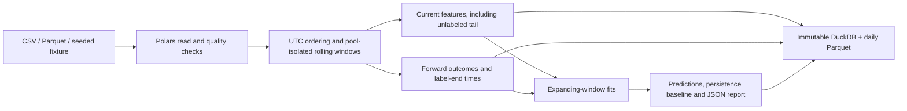
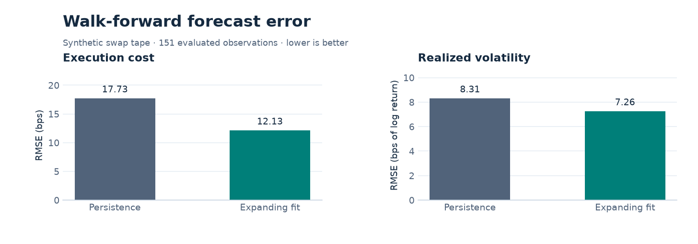

# On-Chain Quantitative Feature Store & Prediction Pipeline

Build a point-in-time research dataset from timestamped pool events, persist it as DuckDB and partitioned Parquet, and evaluate execution-cost and volatility forecasts on later observations. The seeded workflow runs offline.

## Run the full workflow

Requires Python 3.11 or later.

```bash
python -m pip install -e '.[test]'
onchain_feature_store --dataset-dir reports/demo-store --output reports/demo.json
python -m pytest -q
```

With a normalized capture, supply CSV or Parquet and choose a new snapshot directory.

```bash
onchain_feature_store --input data/pool-events.parquet \
  --horizon 3 --window 8 --train-size 80 \
  --dataset-dir reports/capture-store --output reports/capture.json
```

The container exposes the same command.

```bash
docker build -t feature-store .
docker run --rm feature-store --output /tmp/features.json
```

## Architecture



| Layer | Code | Behavior |
|---|---|---|
| Input | `io.py`, `quality.py` | Validates units, required columns, timestamps and event identity. |
| Features | `core.py`, `materialize.py` | Isolates each pool and derives trailing and forward series. |
| Evaluation | `core.py` | Purges unsettled outcomes at each refit, keeps timestamp ties together and scores both targets. |
| Storage | `warehouse.py` | Publishes DuckDB, UTC-date Parquet partitions and a JSON manifest as one directory. |
| Entry point | `cli.py` | Records source hash or fixture seed, configuration, row counts and evaluation results. |

## Event contract

| Column | Meaning |
|---|---|
| `timestamp` | ISO-8601 event time. Times are converted to UTC. Within a pool, input order breaks timestamp ties. |
| `pool` | Stable pool identifier. For cross-chain data, include chain ID and deployed pool address. |
| `event_id` | Optional immutable source identity, such as transaction hash plus log index. With this field present, uniqueness is enforced per pool. |
| `mid_price` | Positive pool mark in USD per base unit. |
| `volume`, `liquidity_usd` | Swap notional and liquidity proxy in USD. |
| `side` | `buy` or `sell` from the trader's perspective. |
| `gas_gwei` | Positive gas price in gwei. |
| `gas_units`, `native_price_usd` | Optional gas units and native-token USD mark. Omitted values use 210,000 units and the supplied pool mark. |

The rolling volatility is the root mean square of log returns per event. The concentration feature is a trailing trade-notional share within one pool. The cost proxy adds the absolute price move in basis points to trade notional divided by the supplied liquidity proxy. Exported captures carry a SHA-256 source fingerprint.

## Point-in-time evaluation

The cost label observes the next specified horizon's slippage proxy. The volatility label uses the next horizon's returns. Both record the timestamp of the outcome's final observation. A training row becomes eligible only when its label has settled strictly before the first decision in the evaluation fold. Scaling is fitted inside the training fold. The JSON report includes RMSE, MAE and persistence RMSE for both targets. Small batches are still exported and report `insufficient_history` when evaluation lacks settled labels.

The DuckDB snapshot contains `features`, `labels`, `manifest` and, when scored, `predictions`. The latest mature features remain available even when their future outcomes have yet to settle. The Parquet files contain the feature table.

```sql
SELECT timestamp, pool, order_flow_imbalance, gas_cost_usd
FROM features
WHERE pool = 'WETH-USDC'
ORDER BY event_sequence DESC
LIMIT 10;
```

## Reproduced demo results

The default fixture produces 237 feature rows and 151 scored predictions. Execution-cost RMSE is 12.13 bps for the fitted model and 17.73 bps for the persistence baseline. The fixture uses synthetic trade, gas and liquidity inputs.



## Research scope

Historical capture workflows supply normalized marks, notional, and liquidity estimates. Forecast error depends on the input pool universe, normalization, feature windows and execution-cost proxy. The JSON-RPC transport in `rpc.py` is available for upstream capture tooling.

[DuckDB Parquet documentation](https://duckdb.org/docs/stable/data/parquet/overview) · [Polars I/O guide](https://docs.pola.rs/user-guide/io/)
