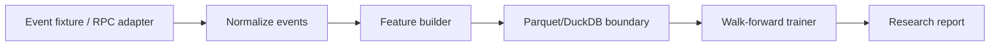

# On-Chain Quantitative Feature Store & Prediction Pipeline

A deterministic research pipeline that converts swap-like events into leakage-safe market-microstructure features and evaluates a short-horizon execution-cost model. The default fixture is synthetic so the full workflow runs without an RPC key.

## Architecture


## Structural overview
`feature_store/core.py` contains event generation, feature engineering, and walk-forward evaluation. The `synthetic_events` function is intentionally deterministic; a production adapter can replace it without changing downstream schemas.

## Workflow
1. Generate or ingest timestamped pool events.
2. Derive volatility, order-flow imbalance, liquidity concentration, gas cost, impact, and slippage.
3. Split chronologically; no random shuffling is allowed.
4. Fit a small baseline model on prior observations only.
5. Report RMSE and observation count.

## Why this approach
A tabular feature contract keeps research reproducible and makes leakage visible. A walk-forward baseline is preferred to a complex model until the feature pipeline proves stable; otherwise model gains can be an artifact of future information.

## Run
```bash
pip install -e .
python -m feature_store.cli
pytest -q
```

## Assumptions and limitations
The fixture approximates a single pool and does not claim to reproduce chain-specific tick math. Gas conversion and impact formulas are explicit research assumptions. Replace the fixture with validated decoded logs before making trading decisions.
